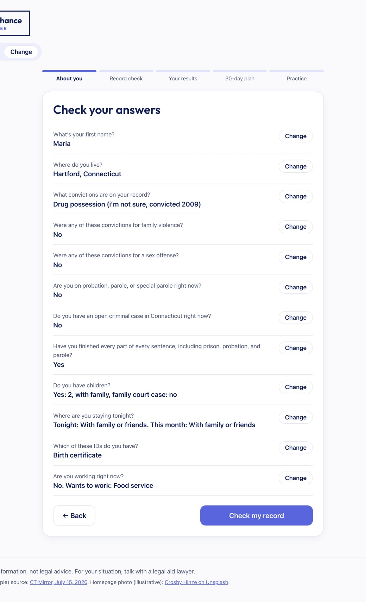
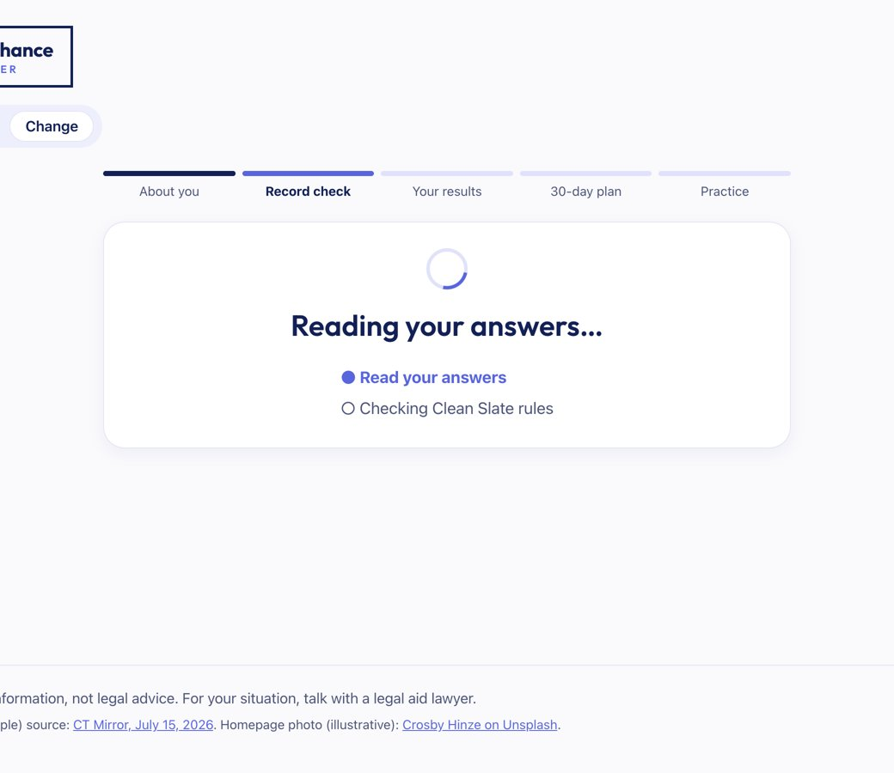
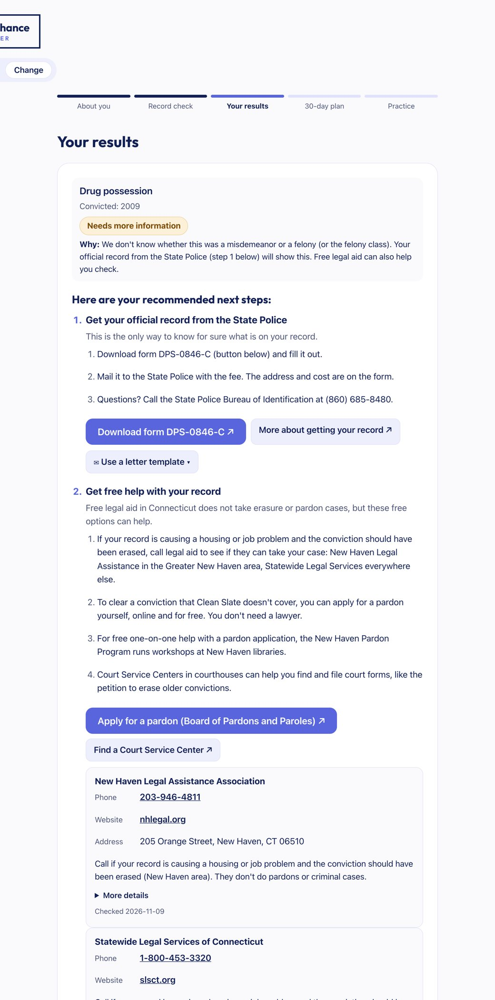
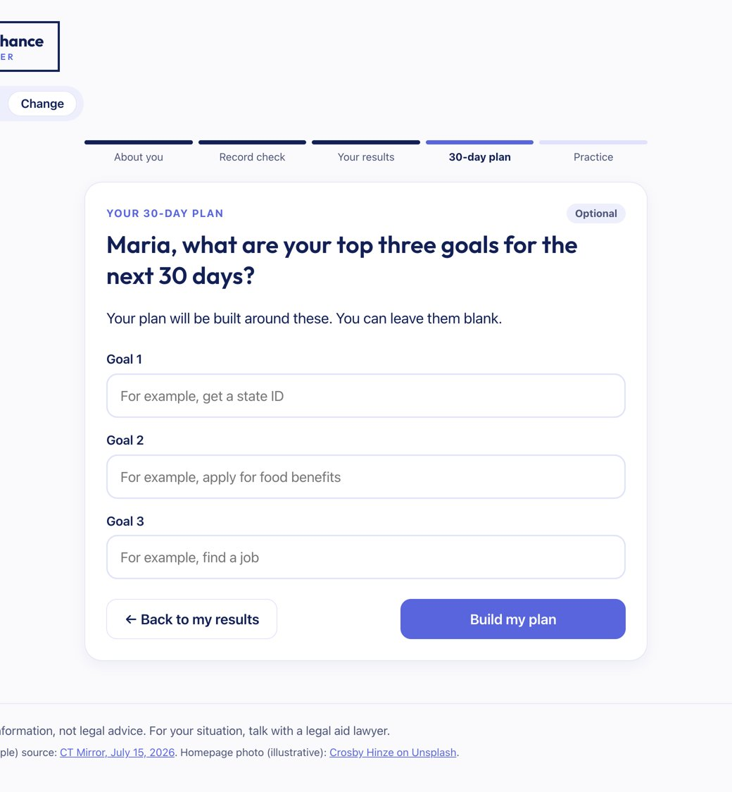
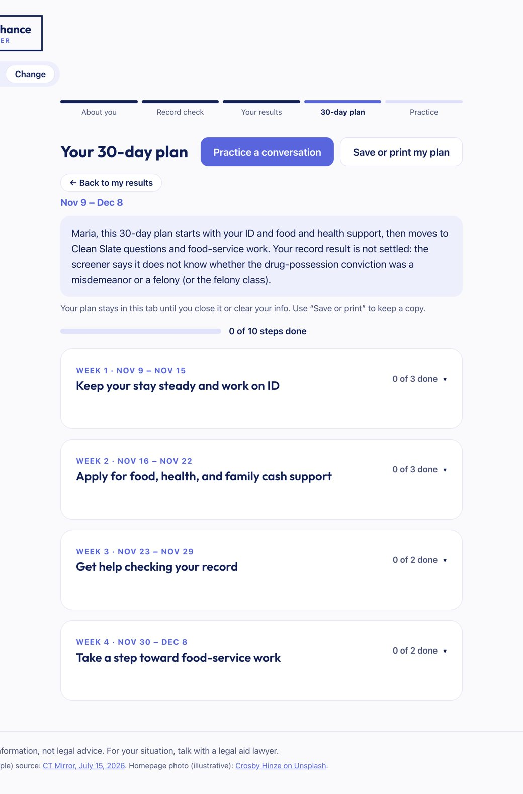

# One real run, step by step

A real self-serve run on the local server, November 9, 2026 (session `aa26a625`, 18:40 UTC). The test case matches the user test: a 2009 drug possession conviction where she isn't sure whether it was a misdemeanor or a felony; she lives in Hartford, has children, and wants an ID, SNAP, and food service work. Every row below is from `output/audit_trail.json` (her first name is stored as "[name]"); token counts are what Portkey reported.

**Total: 7 model calls, 22,824 tokens, about $0.003, about 45 seconds of agent time.**

## Step 1. She answers 12 questions, then clicks "Check my record"

The answers are sent as one plain-language message (`buildAnswerMessage` in `frontend/src/qaForm.ts`). Goals are not asked yet.

## Step 2. Safety guard (AI classifier, after a free keyword check in code)

| | |
|---|---|
| Input | The answer message ("First name: [name] Where I live: Hartford, Connecticut Conviction 1: Drug possession. Level: I'm not sure…") |
| Output | `status: ok` — "shares reentry and record-check details without indicating immediate danger or trying to change the app's rules" |
| Tokens | 968 |

Had the message contained crisis words or an injection attempt, the free keyword check would have stopped it here and the app would have shown its own pre-written message (see `safety-1-prompt-injection-blocked.jpg`, `safety-2-crisis-message.jpg`).

## Step 3. Intake agent: turns the answers into a structured profile

| | |
|---|---|
| Output | `is_complete: true`; profile with town Hartford, one conviction (drug possession, 2009, level unknown), housing, children, IDs, work goal |
| Tokens | 3,022 (1,352 cached) |

## Step 4. Rules engine (plain Python, no AI) decides the Clean Slate result

`backend/rules/clean_slate.py` returns `needs_review` with reason `NEEDS_REVIEW_LEVEL_UNKNOWN` and the plain reason "We don't know whether this was a misdemeanor or a felony (or the felony class)." No tokens. The AI never decides eligibility.

## Step 5. Screener agent: explains the rules result in plain words

| | |
|---|---|
| Input | The rules engine's result (`overall = needs_review`) |
| Output | Headline and explanation; next-step codes `confirm_record_spbi`, `legal_aid_referral` |
| Code guards | Next steps are cut to the ones the rules engine produced; "you can answer no" guidance is only allowed when everything is likely erased |
| Tokens | 2,697 |

## Step 6. Results page

"Needs more information", with the reason from the rules engine and who can confirm it. Next steps come from fixed, checked text (official record first, then free help), with the official form buttons and a fill-in letter template. Contact details come from the checked resource list, never from the AI.

## Step 7. She adds her goals, then clicks "Build my plan"

The goals are free text, so they go through the safety guard again (754 tokens, `status: ok`).

## Step 8. Planner agent: builds the 30-day plan using only checked resources

| | |
|---|---|
| Tool calls | `search_resources` for reentry_center, women_reentry, id_documents, benefits, employment, family_children, legal_aid (town Hartford, has kids), then `get_screener_result` |
| Output | A 4-week plan with 10 steps, each pointing to a resource id from the tool results |
| Tokens | 9,896 (5,371 cached — the shared rules and resource list are a cached prompt prefix) |

## Step 9. Verifier: checks the plan before she sees it

| | |
|---|---|
| Code checks first | Every resource id exists; no phone numbers, addresses, or websites written by the AI; no "you can answer no" wording unless the rules allow it |
| AI check | `approved: true`, with one minor note: "The screener also recommends requesting a current record from State Police, but the plan does not include that step." |
| Tokens | 5,487 (1,726 cached) |

A minor "fit" note doesn't block the plan; a disclosure, certainty, or invented-fact problem would send it back to the planner once, and if it still failed she would see a "Needs human review" banner. (The State Police step is still on her results page, with the form button and letter template.)

## Step 10. The plan

Each week starts folded; she opens a week with its arrow, ticks steps off, and can save or print the plan. Everything stays in her browser tab only.
